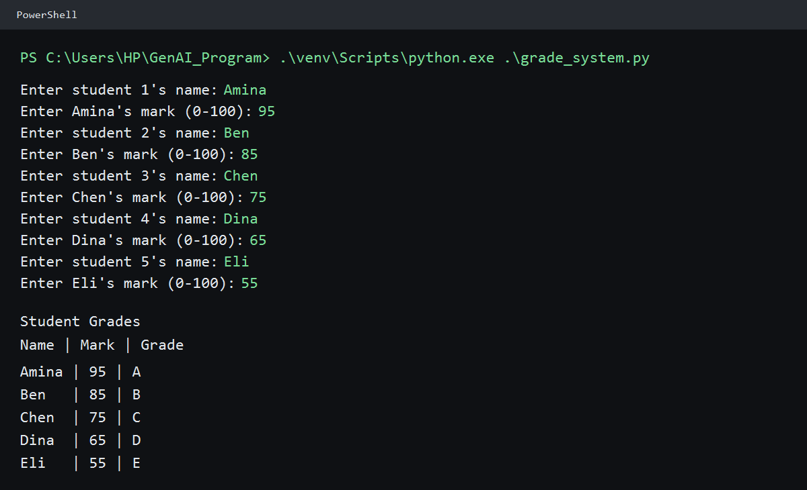

# Student Grade System (CLI)

> Collect five students' marks in the terminal and print their letter grades.

 

## Overview

A pure-Python command-line program with no dependencies. It asks for five students' names and marks, rejects blank names and non-numeric or out-of-range marks (re-prompting instead of crashing), assigns a letter grade and prints the results. See [Streamlit-grade-app](https://github.com/prasanth-sundararajan/Streamlit-grade-app) for the web version.

## Features

- Re-prompts on blank names
- Catches `ValueError` for non-numeric marks
- Accepts decimals, enforces 0 to 100
- Letter grades A to E

## Demo



## Project structure

```text
.
└── grade_system.py
```

## Getting started

**Prerequisites:** Python 3.10+ (no extra packages)

```bash
git clone https://github.com/prasanth-sundararajan/Student_Grade_System.git
cd Student_Grade_System
```

## Usage

```bash
python grade_system.py
```

## License

Released under the [MIT License](LICENSE).

## Author

**Prasanth Sundararajan**, Senior SRE and AI Engineer  
[LinkedIn](https://www.linkedin.com/in/prasanth-s-a093a7109/) · [GitHub](https://github.com/prasanth-sundararajan)
